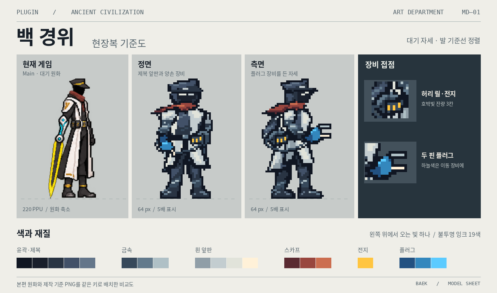
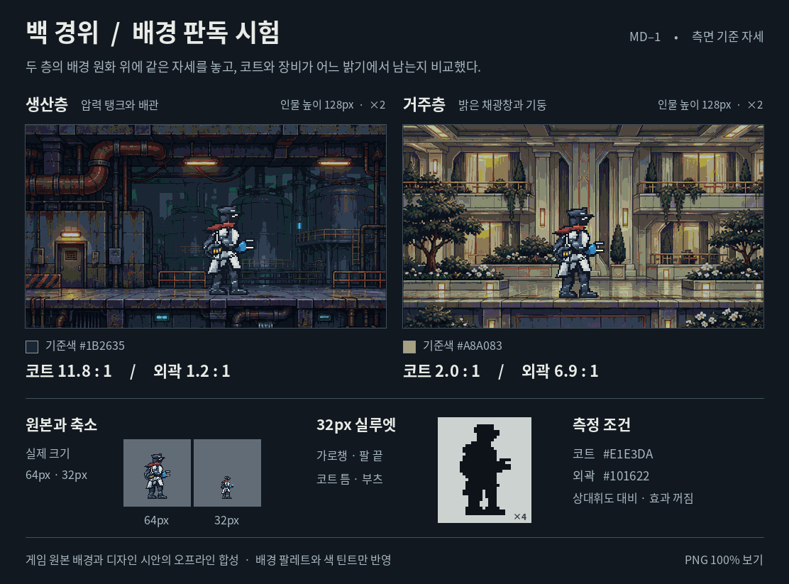

# 백 경위 · 현장복 디자인 기준

MD-1 / 주인공 / Ancient Civilization / Unity 6000.6.7f1

**대기 상태에서 읽을 순서**는 낮게 뻗은 챙과 가려진 얼굴, 밝은 제복과 검은 하체, 허리의 릴과 두 핀 플러그 순서다. 한 손으로 줄을 잡고 다른 손으로 돌리는 인물이라는 점은 두 손 사이의 빈 공간으로 표현한다. 오른손에 칼이 생기는 순간이 제복만 입은 평소 모습과 달라야 한다.

## 1. 진단

비교 대상은 메인 게임의 일반 대기 자세다. `AncientArt.Hero(0)`이 결정하는 사각형을 `BluePlugOfficerArt.Frame(0)`가 원본 `Hero.png`에서 읽는다. 소스는 1536×1024, 대기 자세의 실제 불투명 윤곽은 183×465px(알파 ≥110), 220 PPU에서 높이 2.114유닛이다. 아래 점수는 이 프레임과 플러그 아틀라스를 원본과 32px로 비교한 미술 평가다. Unity 화면을 캡처한 점수가 아니다.

| 항목 | 5점 만점 | 관찰 |
|---|---:|---|
| 실루엣 | 4 | 긴 챙, 잘린 듯한 닫힌 얼굴, 코트 앞자락이 남는다. 대기부터 왼쪽 외곽을 차지하는 긴 칼날 때문에 첫인상이 검사로 기운다. |
| 비율 | 4 | 대기 2.114유닛, 플러그 첫 자세 2.10유닛으로 키는 이미 맞는다. 대기 자세를 32px 높이로 줄이면 폭이 13px라 손과 허리의 겹침이 커진다. |
| 명암 단계 | 3 | 밝기 60/255 미만의 어두운 픽셀이 약 59%, 175 초과는 약 28%다. 흰 코트와 검은 바지는 잘 갈리지만 장갑 중간톤은 작은 화면에서 뭉친다. |
| 팔레트 일관성 | **2** | 대기 한 컷의 알파 ≥110 영역에 고유 RGB 16,391색. 몸에 칠한 청색과 노란 검이 모두 이동 도구처럼 눈에 들어온다. |
| 외곽선 | 3 | 모자챙과 앞자락의 외곽은 이어진다. 원화 단계의 반투명 테두리와 무기 주변 색은 축소할 때 픽셀마다 달라진다. |
| 광원 일관성 | 3 | 흰 어깨와 앞자락에서 위쪽 광원을 읽을 수 있다. 팔꿈치의 푸른 원과 검날의 노란색은 재질의 밝기보다 먼저 읽힌다. |
| 디테일 밀도 | 3 | 32px 표본은 몸과 장비를 합쳐 265개의 유효 픽셀에 219색이 남는다. 모자띠, 팔꿈치, 허리 장식이 비슷한 크기의 점으로 축소된다. |
| 배경 대비 | 4 | 생산층의 어두운 철골에서는 흰 앞판, 밝은 거주층에서는 검은 하체가 윤곽을 지탱한다. 밝은 창 앞의 얇은 단자와 어두운 곳의 릴은 따로 시험할 부분이다. |
| 전구·전기 컨셉 | **2** | 기계팔과 노란 칼은 식별된다. 플러그의 두 핀, 케이블 출구, 허리 잔량계는 평상복 원화에서 분리해 읽기 어렵다. 실제 허리 LED는 별도의 렌더러다. |
| 주변 캐릭터와 픽셀 밀도 | **2** | 평상복 220 PPU, 플러그 몸 110, 기본 적 표본 185, 조커 기본 자세 82.5다. 필터와 원화 축척도 달라 한 화면에서 1px 선의 굵기가 일치하지 않는다. |

**우선 손볼 세 가지**. 팔레트 2→4점 목표는 평상복·장비 전체를 20색 이하로 묶고 하늘색을 이동 접점에만 두는 것이다. 컨셉 2→4점 목표는 대기 몸체에서 칼을 떼고, 릴과 플러그를 별도 파트로 그려 64px에서 두 핀 사이에 빈 1px 이상이 남도록 하는 것이다. 밀도 2→4점 목표는 새 그림의 머리–발을 64 디자인 픽셀로 정한 뒤 주변 인물을 같은 월드 축척으로 비교하는 것이다. 이 목표치는 재채점 결과와 구분한다.

## 2. 결정 사항

도식의 주인공을 현장 치안경찰로 유지한다. 예시의 큰 후드는 제모 뒷면에 붙는 낮은 방진 후드로, 얼굴 전체의 빛나는 고글은 표정을 감추는 짧은 옅은 바이저로 바꿨다. 붉은 스카프는 움직임을 보이면서도 전기·충전 신호와 겹치지 않는다. 배터리는 기존 게임에서 보이는 허리에 둔다.

| 제작 방법 | 같은 범위의 작업량 견적¹ | 이 캐릭터에서 생기는 차이 |
|---|---|---|
| A. 전신 프레임 도트 | 4개 하체 자세군 × 4개 장비 행동 × 평균 6프레임 = 최대 96장 | 코트·체중 이동을 한 장 안에서 가장 자유롭게 그릴 수 있다. 달리는 중 장비가 달라지면 양손·줄의 조합까지 다시 그린다. |
| B. 전신 파트 리깅 | 약 18개 파트, 12개 본, 8개 기본 클립 | 체형이나 길이 수정에 빠르다. 1px 손·단자를 회전시키면 깜빡일 수 있어 4방향 손 대체 도안과 점검이 추가된다. |
| **C. 프레임 몸 + 별도 장비·팔** | 하체 4군 × 평균 6장 = 24장, 상체 4행동 × 평균 3장 = 12장, 별도 장비·팔 약 8개 | 실루엣과 접지 포즈는 직접 그리면서 좌·우 손 소켓, 릴 출구, 무기 피벗을 공유할 수 있다. 기존 플러그 코드가 이미 이 구조를 사용한다. |

¹ 대기·달리기·공중·착지와 장비 행동 4종을 비교하기 위한 1인 작업 추정량이다. 이번 납품 범위는 정면·측면 각 1포즈다. 이 수치를 실제 제작 프레임이나 개인별 소요 시간으로 쓰지 않는다.

## 3. 산출물

### 체형과 소켓

두 PNG의 캔버스는 **56×68px**, 머리 꼭대기 y=2부터 밑창 y=65까지 **가시 높이 64px**다. 아래 좌표는 이미지 왼쪽 위가 (0,0)이고 y가 아래로 증가한다. 발 피벗은 두 포즈 모두 (28,66), Unity Custom Pivot으로 (0.5, 0.0294)다.

| 그릴 부위 | 정면 | 측면 |
|---|---|---|
| 전체 폭과 비율 | 장비 포함 33px. 몸통 폭 23px(y=22 기준), 머리 파트 19×16px | 전체 폭 37px. 몸통 폭 18px(같은 높이), 후드·챙 포함 머리 파트 20×15px |
| 얼굴과 후드 | 가로 8px 안에 끊어진 엷은 바이저. 눈썹·입 생략 | 후드가 챙 뒤에서 목으로 꺾인다. 바이저 마스크는 4픽셀, 얼굴을 가로질러 파란 빛을 켜지 않는다. |
| 기계팔·손 | 오른 어깨 (18,20) → 팔꿈치 (16,27) → 그립 (15,33). 장갑 폭 약 6px | 어깨 (22,20) → 팔꿈치 (23,27) → 그립 (30,32). 상·하완 연결 길이 약 7+9px. 장갑 5×4px 내외 |
| 반대 손과 릴 | 왼손 (37,33). 릴이 화면 오른쪽. | 왼손 (10,34)이 릴 출구 (12,34) 쪽 줄을 쥔다. 오른손과 20px 간격 |
| 다리·발 | 다리 파트 y=35…65. 앞쪽 밑창 폭 11px. 부츠 목 높이 약 7px | 다리 파트 y=34…65. 무릎 (30,49), 발끝 (39,65), 밑창 폭 13px |
| 스카프 | 목둘레·꼬리를 합쳐 26×8px 안쪽 | 매듭 뒤로 약 14px, 꼬리 폭은 약 4px. 끝을 뾰족하게 꺾어 뒤쪽 방향을 알린다. |
| 플러그·전지 | 겨드랑이에서 떨어진 위치에 수납. 창 3개는 1×2px씩 | 양쪽 핀의 밝은 면은 x=39…43, y=27과 32. 길이 5px, 두 줄의 중심 간격 5px. 전지는 x=16,18,20의 독립 창 3개 |

측면은 오른쪽을 바라본다. 캐릭터의 해부학적 왼손이 줄을 쥐고 오른손이 플러그 쪽 줄을 놓는다. 정면에서는 캐릭터의 오른쪽이 화면 왼쪽에 보인다. 좌향 작업은 몸 중심축 기준으로 X를 한 번만 대칭하고 손 역할을 그대로 유지한다. 상태가 바뀌어도 화면의 발바닥 기준선과 손잡이 피벗을 맞춘다.

### 색과 장비 신호

정면·측면 공통 **불투명 잉크 19색 + 투명**. 램프는 왼쪽에서 오른쪽으로 어두운 순서다. 기본 광원은 화면 왼쪽 위 약 45°. 그림자가 짙은 외투 안감과 밝은 앞판을 큰 면으로 나눈다.

| 재질 | sRGB 잉크 | 사용 규칙 |
|---|---|---|
| 먹색 제복 | `#101622` `#191F2B` `#293443` `#425168` `#64768A` | 앞 두 색은 외곽·얼굴, 가운데 2색은 옷감과 주름, 마지막은 꺾인 면에만. |
| 기계팔·핀 금속 | `#37495B` `#637A8C` `#AFC0C6` | 금속판 1장에 바탕 1면과 하이라이트 1줄. 발뒤꿈치와 앞코의 짧은 반사선에도 중간색을 쓴다. |
| 백색 제복·옅은 반사광 | `#909EA7` `#C3CDD0` `#E1E3DA` `#FFF1D8` | 밝음 2단은 어깨와 앞판에 묶는다. 가장 밝은 잉크는 바이저와 단자 끝 등 몇 픽셀에 한정한다. |
| 벽돌색 스카프 | `#5A2A31` `#99463E` `#CC6E50` | 어두운 목, 꼬리의 넓은 면, 가장자리 1줄의 순서. |
| 충전 | `#FFC540` | 램프 1칸에 불투명 픽셀 2개. 색과 켜진 칸 수를 함께 쓴다. |
| 이동 장비 | `#225181` `#3387BD` `#5CCBFF` | 플러그 절연 몸체의 음영–표면–전기 접점. 측면 몸 그림에서 이동색 #5CCBFF는 플러그의 3px에만 사용한다. |

| 상태 | 표시 규칙 | 분리·합성 방법 |
|---|---|---|
| 비장착 / 미충전 | 두 금속 핀과 릴의 홈이 실루엣에 남는다. 3칸 모두 어두움 | 제복 몸에는 노란 검을 굽지 않는다. 평상시 홍채나 손등에 이동색을 붙이지 않는다. |
| 충전 1 / 2 / 3 | 기존 표시 입력 1–39, 40–79, 80 이상일 때 1 / 2 / 3칸. 0이면 0칸. 3칸이 곧 최대 충전량이라는 뜻은 아니다. | 기존 램프의 점등색 #FFC540, 하이라이트 #FFF5BA. 칸 수가 바뀌는 즉시 전환한다. 3단계 전용으로 눈 밑에 따뜻한 반사광 1px, 배터리 옆 2px 방전 1회(60ms)를 제안한다. |
| 블레이드 장착 | 두 핀이 손잡이 소켓에 묻히고 왼손 릴에서 손잡이까지 코드 1줄. 켜진 날은 노란색 | 칼·플러그·줄을 독립 파트로 둔다. 허리에 걸린 같은 플러그를 동시에 그리지 않는다. |
| 강한 피격 / 강제 분리 | 첫 60ms 손을 열고, 다음 80ms 팔꿈치를 몸쪽으로 2px 당긴다. LED 칸 수는 잔량을 계속 표시한다. | 후속 애니메이션용 도안 값. 전기 이동 신호는 실제 연결 해제와 동시에 끈다. |
| 저체력 | 기존 저체력 신호가 켜질 때 배터리 **테두리**만 900ms 주기 중 150ms 한 번 점등 | 잔량 0~3칸과 독립한다. 눈·코트 전체를 점멸시키지 않는다. |
| 발광 마스크 | 눈/바이저, 배터리 3칸, 플러그 핀 접점, 코드 안쪽 라인을 4개 채널로 구분 | 눈은 기본 발광 0, 고전압 핀은 #5CCBFF. 무발광 상태에서도 피부·옷과 단자의 경계가 읽혀야 한다. |

전용색 점검 결과, 월드의 집행관 입자 #66CCFF와 위험 효과 #61C9FF는 이동색 #5CCBFF와 가깝다. 주인공에서는 이동을 두 핀과 연속 곡선, 충전을 호박색 막대 3개, 위험을 꺾인 띠·해칭으로 읽게 한다. 피격 신호에 쓰는 따뜻한 주황 #FFAB4A는 위험 쪽에 남긴다. 실제 다른 캐릭터의 팔레트 통일 여부는 별도 아트 패스로 확인한다.

### 크기 규칙

새 디자인 그리드는 **30 디자인 px = 1월드 유닛 = 설계상의 1타일**로 잡는다. 눈금 1·2·3배는 각각 소스 1px를 화면 1×1, 2×2, 3×3으로 표시하는 비교 방식이다. 배경 타일 PNG 전체를 30px로 재샘플할 필요는 없다.

| 대상 | 새 도안 1× | 2× 비교본 | 3× 비교본 | 월드 크기 기준 |
|---|---:|---:|---:|---|
| 배치용 타일 1칸 | 30px | 60px | 90px | 1유닛 |
| 백 경위 | 64px | 128px | 192px | 2.13유닛. 기존 원화 2.114유닛과 1% 이내 |
| 일반 적 0번, 기존 포즈 기준 | 52px | 104px | 156px | 약 1.73유닛 |
| 조커, 기존 포즈 기준 | 76px | 152px | 228px | 약 2.54유닛 |
| 필드 허리 LED 베젤 | 9×7px | 18×14px | 27×21px | 기존 31 PPU의 9×7px 부품에 근접 |
| 화면 UI 16px 아이콘 | 16px | 32px | 48px | UI는 캔버스 단위에서 정수배 처리 |

현재 몸의 실제 키를 정확히 유지해야 하면 후속 적용 시 시각 자식에만 약 0.991배(2.114 ÷ 2.133)를 쓴다. 물리 캡슐 0.72×2.10유닛과 이동 속도는 이 계산의 대상에서 제외한다.

### 이미지 제작용 영어 프롬프트 5종

각 프롬프트 앞에 아래 문장을 붙이고 **같은 정면·측면 기준 PNG**를 이미지 레퍼런스로 사용한다. 시드를 지원하는 도구에서는 채택한 시드와 모델 버전을 함께 고정한다. 시드가 같아도 손 위치·모자 각도는 두 기준 PNG로 대조한다.

> Original industrial Korean city patrol lieutenant, tall adult proportions, opaque shadow under a low peaked cap nested in a short angular work hood, chalk-cream and ink-black split coat, one brick-red scarf, articulated gunmetal right forearm, three amber waist battery windows, compact two-pin plug. Flat clusters, single upper-left key light, orthographic, consistent model.

| 용도 | 영어 프롬프트 |
|---|---|
| 정면 컨셉 | Full-length front elevation. Stand evenly on both boots. Keep the hat peak visible at both sides, the black face plane unbroken except for a fine ivory visor, and both cream chest panels legible. Show the prosthetic on the figure's anatomical right. Empty hands, blade detached. |
| 횡스크롤 측면 | Right-facing full-body gameplay idle at 64 visible pixels tall. Separate the nose of the cap, short scarf tail and cable exit from the torso silhouette. Leave a gap between the two plug pins. Keep the free hand clear of the hip reel. Use transparent surroundings and a common boot baseline. |
| 포즈 시트 | Same side elevation in seven equally spaced cells. Show walk contact, walk passing, jump apex, then blade vertical cut, horizontal cut and diagonal cut, followed by a neutral recovery. Keep the same sole anchor, coat length and head size. Attach the blade to the right hand only in the three attack cells. |
| 얼굴·후드 확대 | Orthographic close study of the same cap and fitted fabric hood, front and right profile. Show where the rigid peak overlaps the soft rear fold. Only a narrow ivory slit crosses the masked face. Four grouped values, no facial expression and no reflected cyan. |
| 장비 상세 | Exploded orthographic equipment sheet on one grid: right mechanical forearm and quarter-turn plug socket, cable reel with exit notch, separate amber battery with three windows, two-prong plug with a rubber tail, and blade hilt socket. Show how the pins enter the hilt. Use sky blue only on plug contacts and the cable energy line. |

공통 제외 문구는 다음과 같다. *visible human face, long cape covering equipment, chibi proportions, chain links, permanent blade on idle, extra hands or pins, full-body cyan glow, gradient dithering, soft airbrush, perspective foreshortening, text, watermark, scene background.*

## 4. 적용 방법

1. 디자인 원본은 아래 파일 목록의 측면 레이어 파일로 연다. 측면과 정면을 같은 발 기준선에 놓는다. 몸, 오른팔, 릴과 허리 램프, 플러그를 차례로 켜 보고 장비를 가려도 경위의 외곽이 유지되는지 확인한다.
2. 새 이미지를 받아 도트로 정리할 때는 Aseprite 또는 Krita에서 발·머리 표식을 먼저 맞춘 후 **최근접 보간으로 딱 한 번** 줄인다. 알파 128을 경계로 클린업하고 고정 팔레트로 인덱싱한다. 디더링은 0%. 흰옷 경계를 건드리지 않도록 빈 배경에서 시작한다.
3. 직접 그릴 때는 ① 머리–발 64px의 단색 실루엣 ② 옷감에 암·중암·중명·밝음 4단계 ③ 1px 외곽과 1px 음영 틈 ④ 장비별 발광 마스크 ⑤ 모자챙·어깨·핀에 국소 하이라이트 순서로 작업한다. 마감 우선순위는 손과 실루엣, 눈 틈, 장비 접합부다.
4. 후속 모션에 넘길 때 측면 기준본을 원본으로 복제한다. Unity 시험 임포트 값은 Sprite / Single, 30 PPU, Point, Compression None, Mip Maps Off, Full Rect. 현재 일반 대기 원화 로더는 Bilinear를 지정하므로 새 도안에 같은 경로를 그대로 적용하면 임포터 Point가 덮인다. 기존 좌우 손 소켓 및 발 피벗을 재사용한다.
5. 현행 대기 모습을 확인하려면 `Assets/Scenes/Main.unity` → ▶ → **새 순찰 시작** 또는 **이어하기** → 지면에서 이동키를 뗀다. 플러그 시험의 몸 시트는 타이틀의 **파란 플러그 시험 · 빨래골목**에서 비교한다. 새 그림은 이 폴더의 기준본으로 열어 검토한다.

## 5. 합격 기준과 검사

- **파일 실측**. 정면 33×64px, 측면 37×64px. 양쪽 모두 불투명 RGB 19개, 알파는 0·255만 사용한다. 56×68 원본을 28×34로 최근접 축소한 측면 가시 영역은 18×32px다. 원본 비율을 임의로 넓히지 않았다.
- **편집 원본 검사**. 두 ORA의 가시 레이어를 합치면 각각의 PNG와 픽셀이 일치한다. `LED 1/2/3` 레이어만 조절하면 0·1·2·3칸에서 호박색 픽셀 수가 0·2·4·6이 된다. 숨긴 그룹 안에는 눈·전지·핀·케이블의 흰색 마스크 4장이 있다.
- **배경 기준**. 밝은 코트와 먹색 외곽 중 적어도 한쪽이 각 대표 배경에서 3:1 이상인지를 본다. 생산층 대표색 #1B2635에 코트 #E1E3DA는 **11.78:1**, 외곽 #101622는 **1.19:1**이다. 거주층 대표색 #A8A083에는 각각 **2.02:1**, **6.91:1**이다. 이 항목은 두 배경 모두 통과했다.
- **남은 약점**. 배경 무늬까지 포함한 실제 합성 위치에서 외곽 전체의 대비 중앙값은 생산층 **1.19:1**, 거주층 **3.53:1**이다. 생산층의 어두운 부츠는 여전히 철골에 일부 묻힌다. 발뒤꿈치와 앞코에 추가한 3px 반사선이 달릴 때도 읽히는지는 움직임을 넣은 뒤 검사한다.
- **검사 범위**. 판독표는 실제 배경 PNG에 게임의 32색 배경 팔레트와 틴트를 적용한 오프라인 합성이다. 발광은 껐다. Unity의 실시간 조명, 움직이는 발판, 인물 식별 사용자 테스트는 아직 측정하지 않았다.

최종 사람 판독 기준은 3명 중 2명 이상이 이름표를 숨긴 32px 단색 실루엣에서 경위를 고르고, 64px에서는 2초 안에 플러그와 배터리 위치를 각각 짚는 것이다. 32px에서 LED 3칸을 각각 세는 것은 요구하지 않는다. 후속 동작도 같은 카메라에서 볼 때는 모자 뒷선, 코트 트임, 하체 비율을 대기 기준본과 대조한다. 이 문서와 두 정지 포즈가 MD-2 대기 모션의 입력이다.

## 6. 흔한 실수

- **후드가 얼굴·챙을 삼킨다.** 얼굴을 감싸는 옆선은 1px로 끝내고 모자와 이마 사이의 검은 면을 남긴다. 양쪽 눈을 각각 큰 파란 점으로 칠하면 경위보다 플러그가 먼저 연상된다.
- **발 위치를 불투명 외곽 중앙에서 자동으로 잡는다.** 오른손이나 스카프가 움직일 때 프레임 전체가 밀린다. 모든 프레임에 기준본의 발 피벗을 복사한다.
- **빛을 끄면 플러그가 점이 된다.** 두 금속 핀 주위의 어두운 홈을 1px 이상 유지하고 발광을 별도 레이어로 끈 뒤 1배로 본다.
- **LED가 항상 만충으로 보인다.** 기준본의 점등 예시는 포즈 확인용이다. 런타임 이식 때 점등 레이어를 벗겨낸 후 실제 잔량으로 0~3칸을 그린다.
- **Unity 필터와 원화 해상도를 혼동한다.** 1536px 아틀라스의 1픽셀과 새 도트의 1픽셀은 월드에서 크기가 다르다. 발을 같은 선에 놓고 가시 높이를 맞춘 뒤 본다.

### 확인에 사용한 프로젝트 파일

- [대기 시트와 PPU](../../Assets/Scripts/AncientArt.cs) · [원화·필터 선택](../../Assets/Scripts/BluePlugOfficerArt.cs) · [보행 프레임 선택](../../Assets/Scripts/AncientLocomotionMotion.cs)
- [메인 캐릭터 생성](../../Assets/Scripts/AncientGame.cs) · [플러그 몸·팔 시트 구조](../../Assets/Scripts/BluePlugPoseAtlas.cs) · [양손 소켓](../../Assets/Scripts/BluePlugCharacterMotion.cs)
- [전지 3칸과 점등 범위](../../Assets/Scripts/FilamentBatteryLamp.cs) · [배경 틴트](../../Assets/Scripts/AncientDistrictBackdrop.cs) · [집행관 신호](../../Assets/Scripts/AncientEnforcerHazards.cs)

### 편집·확인 파일

| 파일 | 용도 |
|---|---|
| [측면 PNG](BaekSide64.png) · [정면 PNG](BaekFront64.png) | 네이티브 해상도 RGBA 도안 |
| [측면 ORA](BaekSide64.ora) · [정면 ORA](BaekFront64.ora) | Krita에서 열기. 시각 파트 10장, 독립 LED 레이어 3장, 숨긴 발광 마스크 4장 |
| [현행 원화·정면·측면 비교](model-sheet.png) · [생산층·거주층 합성](field-check.png) | 동일 키 비교, 축소 및 배경 판독 |
